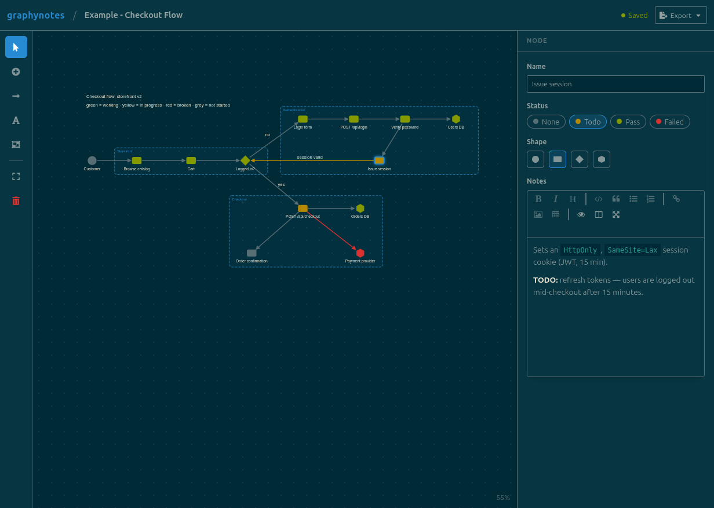
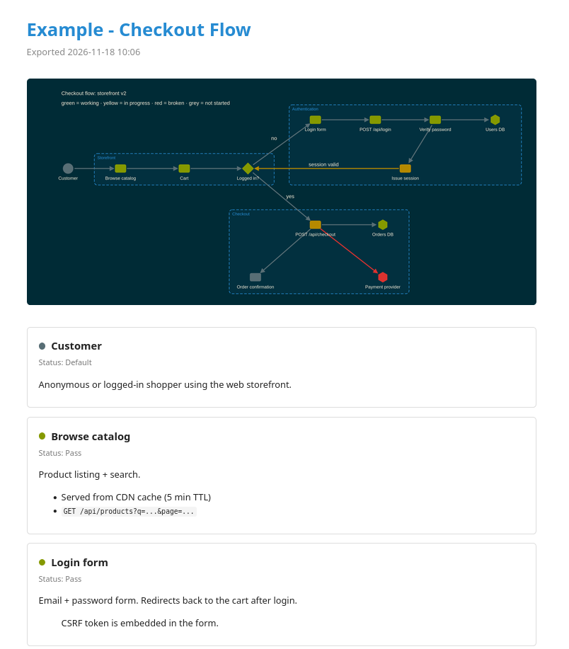

# graphynotes

- A graph-based note-taking app. Designed for keeping track of functions and code paths when reversing.
- A user can graph processes and flows using the graphing tools and put notes in markdown at each of the nodes in the graph
- Notes can be exported to html, markdown, and pdf files
- Work in Progress!

### Example:

Exported to html:

